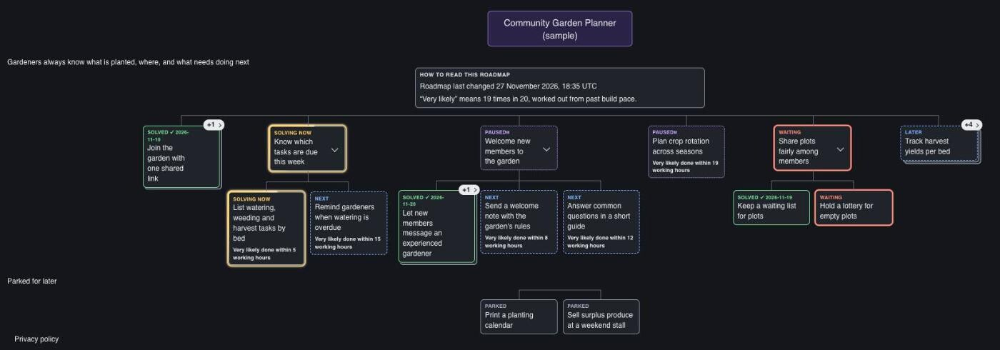

# roadmapping-discovery-tree

[](https://github.com/willemlarsen/roadmapping-discovery-tree/actions/workflows/test.yml)

A small sample of code built by AI agents under the ClickChain governance model. **Live demo:** [the sample roadmap in the current ClickChain Roadmap UI](https://clickchain.ai/share/5hXr_CUIuDq8DjYQFQJf1Z4radCu_n49r5jwnyHWX0A) (best viewed on a laptop), published from this repository's sample data once a day by `.github/workflows/sample-publish.yml`. The pages in `strip/` are an early version of that UI, kept as a code sample: [discovery tree](https://willemlarsen.github.io/roadmapping-discovery-tree/strip/index.html) · [portfolio](https://willemlarsen.github.io/roadmapping-discovery-tree/strip/portfolio.html) (served by GitHub Pages)



A roadmap viewer that shows a product's work as a discovery tree: the goal at the root, the user
problems beneath it, and the parts of each problem beneath that. Each card shows its status
(now, next, blocked, paused, parked, done) and its value and size estimate. A decision log
records every change and who made it, and a pace forecast estimates working hours for the cards
ahead from the repository's own commit history. A portfolio page lists several products side by
side.

Plain JavaScript (ES modules), `node --test`, no dependencies. Node 24 is what CI uses.

## What it does, and what it doesn't

The pages are a read-only view. In the workflow this app was built for, the roadmap changes
through governed work: product and technical coaches edit `roadmap/roadmap.json` and append to
`roadmap/decisions.jsonl` (adding, re-ranking, re-estimating or confirming cards), the product owner
can override, and people read and steer from the tree. So there is no drag and drop, chat, or in-page editing of cards; adding, re-ranking or
finishing a card is a change to the data files, and the decision log records who made it and why.

## Sample data

The repository ships with sample data for two fictional products:

- `roadmap/`: Community Garden Planner (`roadmap.json`, `decisions.jsonl`, `pace.json`)
- `products/seed-library/roadmap/`: Seed Library
- `portfolio/portfolio.json`: the registry that lists both

The sample forecasts (both `pace.json` files) are computed from a **synthetic** git history, not
from this repository's own commits, which are too few. `scripts/sample-history.mjs` builds that
history in a temporary directory: a fixed made-up author, backdated cycle commits that name the
sample products' own cards, made-up session tokens, a few cycles a day over the last two to three
weeks of workdays. It then runs `scripts/pace.mjs --git <that directory>` for each product and
deletes the history. The page treats a forecast as out of date only once the roadmap changes
after it was computed (a newer decision-log entry), never by its age alone, so regenerate after
changing a sample card:

```
npm run sample-history                       # the history ends yesterday
npm run sample-history -- --end 2026-11-23   # or on a given day; same day, same files
```

`test/sample-history.test.mjs` fails if the committed sample pace files differ from what the
script writes for their day.

`docs/design.md` describes the data and the layout; `docs/pace-cli.md` and
`docs/pace-backtest.md` describe the forecast.

## Run it

The pages read the data files over HTTP, so serve the repository root with any static server
and open a page in `strip/`:

```
python3 -m http.server 8000
# then open http://localhost:8000/strip/portfolio.html
# or http://localhost:8000/strip/index.html for the Community Garden Planner tree
```

## Watch it change

The tree page re-reads its files every few seconds and redraws when they change.
`scripts/replay.mjs` shows that: it copies the pages and the sample data into `.replay/`
(ignored by git; the committed sample is never touched), then steps the Community Garden
Planner through six made-up changes, each written only after it passes the roadmap and
decision-log checks: a part moves from next to now, both parts of a card are solved so the card
shows solved, the card is confirmed, a re-rank, and the re-ranked card's part starts. Each
change appends who made it and why to the copy's decision log, which the page lists under
"Recent decisions", and the copy's forecast is rebuilt from the sample history. Each step is
built aside, forecast included, and moved into the copy in one go, so the page never catches a
change ahead of its forecast.

```
npm run replay                                     # terminal 1: copies, waits 15 s, then a step every 6 s
python3 -m http.server 8000 --directory .replay    # terminal 2, within those 15 s
# open http://localhost:8000/strip/index.html
```

`npm run replay -- --wait 5 --pause 3` changes the lead-in and the pause between steps
(seconds). Pauses under about 5 seconds can let the page skip a step. Run it again to start over.

## Tests

```
npm test               # unit tests with line and branch coverage floors
npm run test:browser   # layout checks in headless Chrome (needs a local Chrome; set CHROME_BIN)
```

## Keeping the forecast fresh

The roadmap page reads `roadmap/pace.json`, which `scripts/pace.mjs` writes from this
repository's `git log` and `roadmap/roadmap.json`:

```
npm run pace
```

The page treats a missing, malformed, outdated or more-than-three-days-old file as "forecast
unavailable" and says why. The forecast needs several days of history with cycle commits (a
subject like `C1: <behaviour> (gov-<session id>)`); with too little history the file is written
with status `insufficient` and the page shows no forecast. This repository's own history is that
short, which is why the sample pace files come from the synthetic history described under
[Sample data](#sample-data) instead. Commit the pace file after regenerating it.

Built by Willem Larsen with AI agents under the ClickChain governance model.

## License

MIT. See `LICENSE`.
